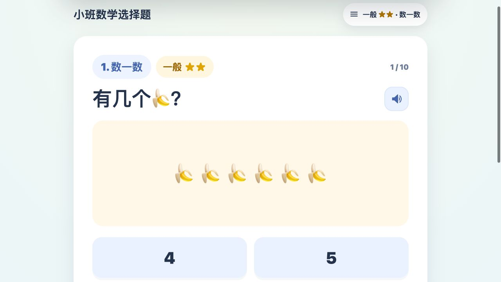

# 小班数学选择题

**数一数、比一比，听着题目做数学练习。**

这是一个给幼儿园小班和中班早期孩子用的数学练习网页。孩子可以听中文题目播报，再点选答案。大按钮方便在平板上操作。

[**在线做一题**](https://dounaoo.github.io/kindergarten-math-quiz/)

## 怎么玩

- 打开右上角设置，在简单、一般、困难中选一个难度。
- 从数数、数量配对、比较、规律、图形等 15 类题里挑一种练习，也可以随机出题。
- 点击题目旁的喇叭听播报，选好答案后点「下一题」。

## 语音与许可

中文语音使用 Kokoro 的 `zf_xiaoxiao` 音色生成，音频随仓库保存。详见[语音清单](audio_manifest.json)和[第三方许可说明](NOTICE.md)。项目代码采用 [MIT 许可](LICENSE)。
